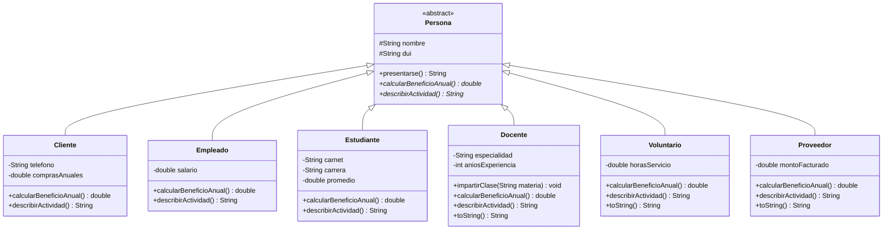

# Diagrama de clases del proyecto 

Notación UML: `#` = protected, `-` = private, `+` = public. El triángulo vacío (`<|--`) representa la relación "es un".

Elementos abstractos: la clase *Persona* se marca con la etiqueta `<<abstract>>` y sus métodos abstractos (*calcularBeneficioAnual()* y *describirActividad()*) se dibujan en cursiva, que es la convención UML para lo abstracto.

## Resumen de la jerarquía

| Clase | Relación | Atributos propios | Implementa los métodos abstractos |
|---|---|---|---|
| *Persona* (abstracta) | Superclase | `#nombre`, `#dui` | Los declara: *calcularBeneficioAnual()*, *describirActividad()* |
| `Cliente` | es una `Persona` | `telefono`, `comprasAnuales` | Sí |
| `Empleado` | es una `Persona` | `salario` | Sí |
| `Estudiante` | es una `Persona` | `carnet`, `carrera`, `promedio` | Sí |
| `Docente` | es una `Persona` | `especialidad`, `aniosExperiencia` | Sí |
| `Voluntario` | es una `Persona` | `horasServicio` | Sí |
| `Proveedor` | es una `Persona` | `montoFacturado` | Sí |